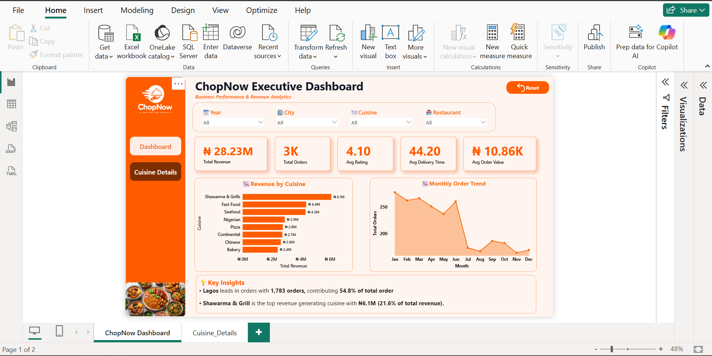

# 🛍️ ChopNow Analytics

## 📌 Project Overview

ChopNow Analytics is an interactive Power BI dashboard developed to analyze the performance of a fictional food delivery business.

The project explores sales performance, customer behavior, product performance, and ordering trends to identify patterns that can support better business decision-making.

---

## 🎯 Business Problem

A food delivery business generates large amounts of transactional data, but raw data alone does not provide a clear picture of business performance.

This analysis was designed to answer key business questions such as:

* How is overall sales performance changing?
* Which products and categories generate the most revenue?
* What ordering patterns can be identified?
* Which customer segments contribute most to sales?
* Are there noticeable trends in sales and order volume?
* What areas of the business may require further attention?

---

## 📊 Dashboard Preview

### Executive Overview

The main dashboard provides a summary of revenue, order volume, average customer rating, average order value, cuisine performance, and monthly order trends.



### Cuisine Details

This page provides a closer look at restaurant-level performance, including revenue, order volume, average ratings, and order distribution by city.


---

## 🔎 Analysis Process

The project followed a typical data analysis workflow:

**1. Data Preparation**
The raw dataset was reviewed and cleaned to prepare it for analysis.

**2. Data Transformation**
Power Query was used to transform and organize the data for analysis.

**3. Data Modeling**
Relevant relationships and calculated fields were created to support the analysis.

**4. Data Analysis**
DAX measures were developed to calculate key business metrics and performance indicators.

**5. Visualization**
The results were presented through an interactive Power BI dashboard.

**6. Business Insights**
The analysis was used to identify meaningful patterns and translate them into business-focused insights.

---

## 💡 Key Insights

The completed analysis identified several patterns in sales, customer behavior, product performance, and ordering activity.

Detailed findings and business recommendations will be documented alongside the completed dashboard.

---

## 🛠️ Tools & Technologies

* **Power BI** — Dashboard development and visualization
* **Power Query** — Data cleaning and transformation
* **DAX** — Measures and analytical calculations
* **CSV** — Source data

---

## 📁 Project Structure

```text
chopnow-analytics/
│
├── README.md
│
├── data/
│   └── chopnow_clean.csv
│
├── dashboard/
│   └── ChopNow_Analytics.pbix
│
├── screenshots/
│   ├── overview.png
│   ├── analysis.png
│   └── insights.png
│
└── documentation/
    └── business-insights.pdf
```
## Key Business Insights

### 1. Geographic Order Distribution
Abuja recorded the highest order volume with **1,049 orders (40.3%)**, followed by Lagos with **935 orders (36.0%)**. Together, these two cities accounted for approximately **76.3% of the 2,600 total orders**.

### 2. Revenue by Cuisine
Shawarma & Grill was the leading cuisine category, generating **₦6.1 million in revenue**, representing **21.6% of total revenue**.

### 3. Annual Revenue Performance
Revenue declined from **₦11.62 million in 2024** to **₦11.10 million in 2025**, a decrease of approximately **4.5%**. Average order value also edged down from ₦10,920 to ₦10,880.

### 4. Customer Ratings
Average ratings were **4.12 in 2024** and **4.11 in 2025**. The January–June 2026 average was **4.02**. Because 2026 contains only six months of data, it should be compared with January–June in previous years before drawing firm conclusions.

### 5. Monthly Order Peaks
The highest-order months were January 2024 (**102 orders**), March 2025 (**99 orders**) and January 2026 (**95 orders**). These represent each year's peak month, not total annual orders.

## Business Recommendations

- **Prioritize key markets:** Investigate restaurant availability, delivery performance and customer demand in Abuja and Lagos, which together generated 76.3% of recorded orders.
- **Learn from leading cuisine categories:** Examine the pricing, menu mix and restaurant performance behind Shawarma & Grill's revenue contribution to identify practices that could benefit other categories.
- **Investigate revenue decline:** Review pricing, discounts, menu mix and order frequency to understand the decrease in revenue between 2024 and 2025.
- **Monitor customer experience:** Track restaurant-level ratings and customer feedback to identify service issues and opportunities for improvement.
- **Use comparable reporting periods:** Compare January–June 2026 against January–June 2025 for a fair assessment of changes in revenue, order volume and customer ratings.
---

## 👤 Author

**Lilian Omale**

Data Analyst | Power BI | SQL | Excel | Python

Interested in using data analysis and visualization to uncover insights and support data-driven decision-making.

